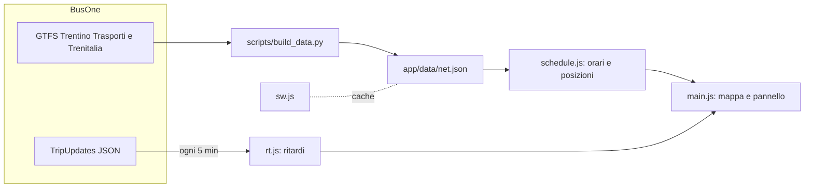

# Architettura

## In breve

L'app è fatta solo di file statici. Una volta al giorno uno script trasforma i GTFS in un unico file compatto; il browser lo combina con i ritardi live di BusOne e calcola da solo dove si trova ogni mezzo.

## Componenti

| File | Ruolo |
|---|---|
| `scripts/build_data.py` | Scarica, filtra, semplifica e compatta i GTFS |
| `app/data/net.json` | Rete completa: 7,3 MB, circa 1,1 MB compressi |
| `app/js/schedule.js` | Calendario, corse attive, posizione lungo il percorso. Logica pura |
| `app/js/rt.js` | Lettura dei TripUpdates e calcolo dei ritardi. Logica pura |
| `app/js/main.js` | Mappa MapLibre, pannello, aggiornamenti periodici |
| `app/js/planner.js` | Pianificatore di viaggio |
| `app/sw.js` | Cache per l'uso offline |
| `data/extra/` | Corse trascritte a mano |
| `app/come-funziona.html` | Spiegazione pubblica di stime e limiti |
| `tests/logic.test.mjs` | Test della logica pura |
| `scripts/check_live.mjs` | Verifica sui feed reali |

## Generazione di `net.json`

1. Scarica i due GTFS da BusOne in `.cache/`.
2. Tiene tutto Trentino Trasporti, e di Trenitalia solo le corse con almeno una fermata nel rettangolo delle ferrovie trentine (`RAIL_AREA`).
3. Unisce le piattaforme nella loro stazione.
4. Semplifica i percorsi con Douglas-Peucker a 8 m.
5. Proietta ogni fermata sul percorso, solo in avanti, per non sbagliare passaggio sulle linee ad anello.
6. Deduplica sequenze di fermate e tempi, così 7.093 corse pesano poco.

Le corse senza percorso (il 3% circa) vengono disegnate in linea retta fra le fermate. Gli orari mancanti vengono interpolati.

Gli ID delle corse live coincidono con quelli del GTFS di BusOne. Per questo gli orari vanno presi da BusOne e non dall'operatore.

## Calcolo della posizione

Il ritardo attuale è il campo `delay` della corsa, che BusOne fornisce per i bus. Per i treni, che non lo hanno, è il ritardo dell'ultimo evento già avvenuto, o in mancanza la prima previsione.

Sui bus i valori delle fermate già superate non vanno usati: BusOne le riporta con un orario schiacciato su "adesso", da cui risulterebbero ritardi finti anche oltre un'ora. Per questo si considerano solo le fermate ancora da raggiungere.

Il mezzo viene poi collocato all'orario `adesso − ritardo`: sosta fra arrivo e partenza e avanza in modo lineare fra due fermate.

Le corse dopo mezzanotte sono gestite controllando anche il giorno di servizio precedente, dato che il GTFS usa orari come `25:10:00`.

## Scelte

| Scelta | Motivo |
|---|---|
| Posizioni calcolate in proprio invece di usare le VehiclePositions | Anche quelle di BusOne sono stime sul percorso. Così il movimento è fluido, si usa un feed in meno e l'app funziona anche offline |
| JSON invece di protobuf | Nessun decoder da includere, a costo di un traffico maggiore |
| Nessun framework né build | Per un prototipo restano solo file da servire |
| Mappa online con OpenFreeMap e DEM AWS | Nessuna chiave; un pacchetto offline completo arriverà solo se serve |
| Riuso di MapLibre e dello stile del progetto Valsugana | Stesso aspetto e stessa versione già collaudata |

## Pianificatore

`planner.js` usa il Connection Scan su tutte le corse del giorno, con un giro per ogni mezzo preso, fino a 5. Così trova sia l'arrivo più rapido sia le soluzioni con meno cambi. Ripete la ricerca da partenze successive e scarta i viaggi peggiori di un altro per partenza, arrivo e cambi. Gira nel browser in meno di 100 ms su un Mac e funziona senza rete.

Il calcolo usa gli orari programmati, cambio minimo 2 minuti e fino a 300 metri a piedi in linea d'aria. Non considera le corse iniziate il giorno prima. I ritardi attuali compaiono accanto a ogni tratta ma non cambiano il risultato.

## Corse manuali

Le corse che mancano dai GTFS stanno in `data/extra/*.json` e il build le fonde in `net.json` con il feed `extra`, che non ha dati live. Scadono da sole a `validTo`. La procedura è nella skill `aggiorna-dati`.

## PWA e offline

| Risorsa | Strategia |
|---|---|
| App e `version.json` | Prima la rete, con ripiego sulla cache dopo 4 secondi |
| `net.json` | Dalla copia locale; si riscarica solo se `version.json` indica un'altra versione |
| Tile di mappa e terreno | Salvati quando vengono visti, massimo 4.000 |
| Feed BusOne | Non passano dal service worker. La pagina salva l'ultima risposta con la sua data in `tn-live` |

All'avvio l'app usa subito i dati salvati, poi controlla `version.json`. Se gli orari sono cambiati li scarica in background e propone di usarli. La versione è un hash del contenuto, quindi non cambia se il file è stato solo rigenerato.

I ritardi si aggiornano ogni 5 minuti, si fermano quando la pagina non è visibile e si possono forzare con il pulsante o aprendo una fermata, al massimo ogni 30 secondi. Senza rete i ritardi salvati valgono per 15 minuti; poi tutti i mezzi passano a "solo orario" e l'avviso riporta la data degli orari. Se lo stile della mappa non è mai stato salvato, parte su uno sfondo neutro e il resto continua a funzionare.

Per pubblicare una nuova versione dell'app bisogna incrementare `VERSION` in `sw.js`, che rimuove le vecchie cache.

## Pubblicazione

`.github/workflows/pages.yml` gira a ogni push su `main` e ogni notte. Scarica i GTFS, genera `net.json` e `version.json`, che non sono nel repo, e pubblica `app/` su GitHub Pages. Se il build fallisce resta online l'ultima versione buona. La versione degli orari dipende solo dal contenuto, quindi l'app riscarica gli orari solo quando cambiano davvero.

## Prossimi passi

1. Raccogliere i ritardi su un piccolo servizio esterno per le statistiche: è l'unico pezzo che richiede un backend.
2. Aggiungere la provincia di Bolzano tramite il GTFS-RT ufficiale di Open Data Hub.
3. Valutare un pacchetto offline completo con PMTiles, come nel progetto Valsugana.
